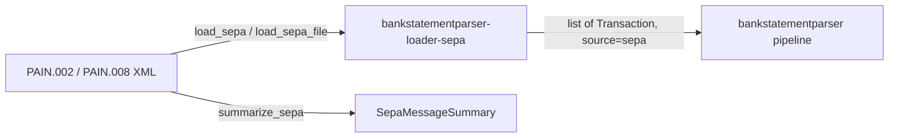

<!-- SPDX-License-Identifier: Apache-2.0 OR MIT -->

<p align="center">
  
</p>

<h1 align="center">bankstatementparser-loader-sepa</h1>

<p align="center">
  ISO 20022 SEPA loader that parses PAIN.002 payment status reports and PAIN.008 Direct Debit collections into bankstatementparser Transaction objects.
</p>

<p align="center">
  <a href="https://github.com/sebastienrousseau/bankstatementparser-loader-sepa/actions"></a>
  <a href="https://pypi.org/project/bankstatementparser-loader-sepa/"></a>
  <a href="https://sebastienrousseau.com/bankstatementparser-loader-sepa/"></a>
  <a href="https://scorecard.dev/viewer/?uri=github.com/sebastienrousseau/bankstatementparser-loader-sepa"></a>
  <a href="LICENSE"></a>
  <a href="https://github.com/sebastienrousseau/bankstatementparser-loader-sepa/blob/main/docs/POLICIES.md"></a>
</p>

<p align="center">
  
</p>

---

## Contents

**Getting started**

- [Install](#install): PyPI, source
- [Requirements](#requirements): toolchain floor, platforms
- [Quick Start](#quick-start): parse a message in three lines

**The bankstatementparser-loader-sepa ecosystem**

- [The bankstatementparser-loader-sepa ecosystem](#the-bankstatementparser-loader-sepa-ecosystem): the core library, the other loaders and writers

**Library reference**

- [Capabilities at a glance](#capabilities-at-a-glance): the current surface by theme
- [Ecosystem comparison](#ecosystem-comparison): short matrix; full table at [`docs/COMPARISON.md`](docs/COMPARISON.md)
- [Benchmarks](#benchmarks): headline numbers; full table at [`docs/BENCHMARKS.md`](docs/BENCHMARKS.md)
- [Features](#features): public API, element mapping, amounts and signs
- [Configuration](#configuration): core options
- [Examples](#examples): runnable example index

**Operational**

- [When not to use bankstatementparser-loader-sepa](#when-not-to-use-bankstatementparser-loader-sepa): limitations
- [Development](#development): make targets, fuzzing, CI
- [Security](#security): guarantees and compliance
- [Documentation](#documentation): all reference docs
- [Stability guarantees](#stability-guarantees): SemVer axis, output stability, minimum toolchain discipline
- [License](#license)

---

## Install

### As a Python library

```bash
pip install bankstatementparser-loader-sepa
```

That installs the loader, `defusedxml`, and `bankstatementparser >= 0.0.35`, which brings `pandas` and `pydantic`.

| Channel | Command | Notes |
| :--- | :--- | :--- |
| PyPI | `pip install bankstatementparser-loader-sepa` | Pulls in `bankstatementparser >= 0.0.35` |
| Source | `git clone https://github.com/sebastienrousseau/bankstatementparser-loader-sepa && cd bankstatementparser-loader-sepa && poetry install` | For development |

Verify the installation:

```sh
python -c "import bankstatementparser_loader_sepa as s; print(s.__version__)"
# -> 0.0.37
```

An isolated virtual environment keeps the loader's dependencies apart:

```sh
python -m venv venv
source venv/bin/activate        # macOS/Linux
venv\Scripts\activate           # Windows
python -m pip install -U bankstatementparser-loader-sepa
```

---

## Requirements

- **Python 3.10 or later.** CI tests CPython 3.10, 3.11, 3.12, 3.13 and 3.14 on Linux, macOS and Windows; [`docs/POLICIES.md`](docs/POLICIES.md) says when the floor moves.
- **[`bankstatementparser`](https://pypi.org/project/bankstatementparser/) 0.0.35 or later**, whose `Transaction` model and `BankStatementParser` base class the loader produces and extends, and **[`defusedxml`](https://pypi.org/project/defusedxml/) 0.7**, which parses the XML.
- No network access, native extensions or system packages of its own.

---

## Quick Start

```python
from bankstatementparser_loader_sepa import load_sepa_file

for txn in load_sepa_file("pain002.xml"):
    print(txn.amount, txn.currency, txn.reference, txn.description)
```

Or parse an in-memory payload:

```python
from bankstatementparser_loader_sepa import load_sepa

report = """<Document xmlns="urn:iso:std:iso:20022:tech:xsd:pain.002.001.03">
  <CstmrPmtStsRpt>
    <GrpHdr><MsgId>STS-2026-0121</MsgId></GrpHdr>
    <OrgnlPmtInfAndSts>
      <TxInfAndSts>
        <OrgnlEndToEndId>E2E-INV-1001</OrgnlEndToEndId>
        <TxSts>ACSC</TxSts>
        <OrgnlTxRef><Amt><InstdAmt Ccy="EUR">64.90</InstdAmt></Amt></OrgnlTxRef>
      </TxInfAndSts>
      <TxInfAndSts>
        <OrgnlEndToEndId>E2E-INV-1002</OrgnlEndToEndId>
        <TxSts>RJCT</TxSts>
        <StsRsnInf><Rsn><Cd>AM04</Cd></Rsn></StsRsnInf>
        <OrgnlTxRef><Amt><InstdAmt Ccy="EUR">25.00</InstdAmt></Amt></OrgnlTxRef>
      </TxInfAndSts>
    </OrgnlPmtInfAndSts>
  </CstmrPmtStsRpt>
</Document>"""

for txn in load_sepa(report):
    print(txn.amount, txn.category, txn.reference, txn.description)
# 64.90 pain002:ACSC E2E-INV-1001 SEPA Status: ACSC
# -25.00 pain002:RJCT E2E-INV-1002 SEPA Status: RJCT (AM04)
```

Both return a flat `list` of `bankstatementparser.transaction_models.Transaction` objects with `source="sepa"`, ready for the rest of a `bankstatementparser` pipeline.

---

## The bankstatementparser-loader-sepa ecosystem

bankstatementparser-loader-sepa is one of the input loaders of the `bankstatementparser` suite, whose packages ship one version together. The full table is in [The suite](docs/suite.md).

| Component | Purpose | Use case |
| :--- | :--- | :--- |
| [`bankstatementparser`](https://github.com/sebastienrousseau/bankstatementparser) | The parser core: CAMT, pain.001, CSV, OFX, QFX, MT940, MT942, BAI2 and PDF statements, and the `Transaction` model | Parsing statements from Python or the CLI |
| **`bankstatementparser-loader-sepa`** | This loader: PAIN.002 and PAIN.008 XML to `Transaction` objects, with rejections signed negative and the status kept | Reconciling SEPA Direct Debit collections and their status reports |
| Other loaders | BAI2, MT942, CFONB 120, CAMT.054 and BACS Standard 18 | Formats beyond the core |
| Writers and transport | XLSX, QIF, OFX and SWIFT writers; EBICS retrieval | Exporting transactions and fetching statements |
| [`bankstatementparser-mcp`](https://github.com/sebastienrousseau/bankstatementparser-mcp), [`bankstatementparser-lsp`](https://github.com/sebastienrousseau/bankstatementparser-lsp) | Agent tools and editor diagnostics over the core | AI agents and MT940 editing |



---

## Capabilities at a glance

| Area | Capability | Status |
| :--- | :--- | :--- |
| Loading | `load_sepa` (`str` or `bytes`) and `load_sepa_file` (path) to `list[Transaction]` | Shipped |
| Summary | `summarize_sepa` to a `SepaMessageSummary` (type, message id, creation time, account, currency, count, total) | Shipped |
| Core integration | `SepaStatementParser`, a `BankStatementParser` registered as `sepa`, `pain002` and `pain008` in `bankstatementparser.loaders` | Shipped |
| Messages | PAIN.002 `TxInfAndSts` statuses and PAIN.008 `DrctDbtTxInf` collections, any `pain.00x.001.xx` namespace | Shipped |
| XML safety | `defusedxml` refuses entity declarations, internal or external | Shipped |
| Group status | `GrpSts` and `OrgnlGrpInfAndSts` | Not read |
| Other messages | PAIN.001, PAIN.009 to PAIN.012 mandates, camt | Not in this loader |

---

## Ecosystem comparison

Two other Python packages on PyPI handle SEPA PAIN messages; neither reads PAIN.002. Every cell comes from the projects' own source code, read on 2026-11-27.

| Project | Reads PAIN.002 | Reads PAIN.008 | Output |
| :--- | :---: | :---: | :--- |
| **bankstatementparser-loader-sepa** | Yes | Yes, any version | Signed `Transaction` objects |
| [`sepa`](https://github.com/VerenigingCampusKabel/python-sepa) 0.5.4 | No | `pain.008.001.07` | Nested dicts of element text |
| [`sepaxml`](https://github.com/raphaelm/python-sepaxml) 2.7.0 | No | No (writes it) | XML |

See [`docs/COMPARISON.md`](docs/COMPARISON.md) for the evidence and complete matrix.

---

## Benchmarks

`benches/bench_load_sepa.py` times `load_sepa` and `summarize_sepa` on PAIN.008 collections and PAIN.002 reports of 10 to 50,000 transactions. From 10 to 50,000 transactions the cost per transaction rises 1.16x for PAIN.008 and 1.68x for PAIN.002; parsing the XML dominates, so a summary costs nearly as much as a load.

| Scenario | Result | Environment |
| :--- | ---: | :--- |
| `load_sepa`, PAIN.008, 1,000 transactions (327 KiB) | 17.37 ms | Apple M1 Pro, macOS 27.2.1, CPython 3.12.16 |
| `load_sepa`, PAIN.008, 50,000 transactions (16.4 MiB) | 1,148.20 ms | Apple M1 Pro, macOS 27.2.1, CPython 3.12.16 |
| `load_sepa`, PAIN.002, 50,000 transactions (8.9 MiB) | 1,297.52 ms | Apple M1 Pro, macOS 27.2.1, CPython 3.12.16 |

See [`docs/BENCHMARKS.md`](docs/BENCHMARKS.md) for methodology and full results.

---

## Features

<!-- --8<-- [start:features] -->

### Public API

```python
from bankstatementparser_loader_sepa import (
    SepaMessageSummary,
    SepaStatementParser,
    load_sepa,
    load_sepa_file,
    summarize_sepa,
)
```

| Class / Function | Signature | Returns |
| :--- | :--- | :--- |
| `load_sepa` | `load_sepa(xml_content)`: a `str` or `bytes` | `list[Transaction]` |
| `load_sepa_file` | `load_sepa_file(path)`: a `str` or `os.PathLike` | `list[Transaction]` |
| `summarize_sepa` | `summarize_sepa(xml_content)`: a `str` or `bytes` | `SepaMessageSummary` |
| `SepaStatementParser` | `SepaStatementParser(file_name)` | `BankStatementParser` with `parse()` (DataFrame), `to_transactions()` and `get_summary()` (dict) |

`SepaMessageSummary` is a frozen dataclass with the fields `message_type` (`PAIN.002`, `PAIN.008`, or the root element's name when neither is found), `message_id` (`MsgId`), `creation_date` (`CreDtTm`), `account_id` and `currency` (the first transaction's, `EUR` when there is none), `item_count` and `total_amount` (the sum of absolute amounts).

### Message detection

Elements are matched by local name, so the namespace and the message version do not matter. The first `CstmrPmtStsRpt` or `CstmrDrctDbtInitn` element decides the type. Without either, the loader falls back to PAIN.002 or PAIN.008 only when a `TxInfAndSts` or `PmtInf` element carries text of its own (not only child elements); otherwise the message gives no transactions and `message_type` is the root element's name.

### PAIN.008: one transaction per `DrctDbtTxInf`

| `Transaction` field | Source |
| :--- | :--- |
| `account_id` | The `PmtInf` block's `CdtrAcct` (`IBAN`, else `Id`), else the transaction's first `IBAN` or `Id`, else `SEPA_DD` |
| `currency` | The `InstdAmt` `Ccy` attribute, else `EUR` |
| `amount` | `InstdAmt`, **positive** |
| `booking_date`, `value_date` | The block's `ReqdColltnDt` |
| `description` | `SEPA Direct Debit - <first Nm>`, followed by the `Ustrd` (else `Strd`) remittance text in parentheses when there is one |
| `reference` | `EndToEndId`, else `MndtId` |
| `category` | `pain008:direct_debit` |

### PAIN.002: one transaction per `TxInfAndSts`

| `Transaction` field | Source |
| :--- | :--- |
| `account_id` | The status's first `IBAN`, else `Id`, else none |
| `currency` | The amount's `Ccy` attribute, else `EUR` |
| `amount` | The first `OrgnlTxAmt`, `InstdAmt` or `Amt`, **negative when `TxSts` is `RJCT`** |
| `booking_date`, `value_date` | `AccptncDtTm`, when present |
| `description` | `SEPA Status: <TxSts>`, followed by the first `Cd` (else `AddtlInf`) in parentheses when there is one |
| `reference` | `OrgnlEndToEndId`, else `OrgnlTxId`, else `StsId`, else the message's `MsgId` |
| `category` | `pain002:<TxSts>` |

A status with no `TxSts` is read as `RJCT`.

### Amounts

An amount is ISO 20022's plain decimal: ASCII digits with an optional fraction, converted to `decimal.Decimal`, never `float`. Anything else (an empty element, a sign, an exponent, `NaN`, `Infinity`, other scripts' digits) reads as `0.00`, as does a transaction with no amount element.

### Errors

`load_sepa`, `load_sepa_file` and `summarize_sepa` raise `xml.etree.ElementTree.ParseError` when the payload is not well-formed XML or declares an encoding the parser cannot use, and a `defusedxml.DefusedXmlException` (a `ValueError`) when it declares an entity, internal or external. Missing or unreadable elements never raise: they take the defaults above. `load_sepa_file` also raises `OSError` when the file cannot be read.

<!-- --8<-- [end:features] -->

---

## Configuration

The loader has no options, configuration file or environment variables: the element mapping and the sign convention above are fixed, so the same message always loads the same way. Installing the package registers `SepaStatementParser` under the `sepa`, `pain002` and `pain008` names in the `bankstatementparser.loaders` entry-point group, which is how the core discovers it; nothing needs to be configured for that.

---

## Examples

[`examples/`](examples/) holds two runnable scripts, each run in CI against an inline sample, so no data files are needed:

| Example | Demonstrates |
| :--- | :--- |
| [`01_basic_usage.py`](examples/01_basic_usage.py) | `load_sepa` and `summarize_sepa` on a PAIN.008 collection and the PAIN.002 report that settles one debit and rejects the other |
| [`02_advanced_workflow.py`](examples/02_advanced_workflow.py) | `SepaStatementParser` reading a status report from disk as a DataFrame and a summary, then listing the rejections |

```sh
python examples/01_basic_usage.py
```

---

## When not to use bankstatementparser-loader-sepa

- **You need account statements.** Booked transactions come in camt.053 (the core) or camt.054 (`bankstatementparser-loader-camt054`); PAIN.002 and PAIN.008 are instructions and statuses, not bookings.
- **You need the group status.** `GrpSts` and the original group details are not read; only transaction-level statuses become transactions.
- **You need to write PAIN messages.** This loader only reads.
- **You need schema validation.** Elements are found by name wherever they sit; a message that is valid XML but not valid against the XSD still loads.

---

## Development

```bash
git clone https://github.com/sebastienrousseau/bankstatementparser-loader-sepa.git
cd bankstatementparser-loader-sepa
poetry install
make check
```

`make check` runs the local gates: `ruff` lint and format, `mypy --strict`, the complexity baseline (`scripts/check_complexity.py`), `bandit`, `pytest` with a 100% line + branch coverage floor, `interrogate` at 100% docstring coverage, and the examples. Other targets: `make fuzz` (Atheris, 60 s, Linux x86_64 with Python 3.12+), `make bench`, `make audit` (`pip-audit` on every locked set), `make docs` (the MkDocs manual, `--strict`) and `make demo` (re-renders the GIF above with VHS from `.github/demo.tape`). CI adds the OS by Python matrix, the fuzz run, CodeQL, `pip-audit` and the Docs Lint gates. [`CONTRIBUTING.md`](CONTRIBUTING.md) covers branches and commit signing.

---

## Security

- **Read-only.** The loader only reads text and files you pass it; it writes nothing.
- **Hardened XML.** Parsing goes through `defusedxml`, which refuses entity declarations, internal or external, so a message cannot pull in files or expand into gigabytes; an external DTD is never fetched.
- **No network, no code execution.** Parsing is element lookups into dataclasses.
- **Decimal arithmetic** for every amount, and only ISO 20022 decimals count as amounts.
- **Fuzzing.** `fuzz/fuzz_load_sepa.py` drives `load_sepa` and `summarize_sepa` with Atheris in CI, seeded with the repository's fixtures, and fails on any exception but the two documented refusals, on any malformed `Transaction` and on any disagreement between the load and the summary.
- **Supply chain.** Dependencies are locked in `poetry.lock`, CI installs hash-pinned exports of it, and `pip-audit` and CodeQL run on every change. Releases publish to PyPI through OIDC trusted publishing and carry cosign signatures, SLSA provenance and SBOMs; every workflow action is pinned by commit SHA except the SLSA generator, which must be referenced by tag.

Report vulnerabilities according to [`SECURITY.md`](SECURITY.md).

---

## Documentation

- **User manual:** [sebastienrousseau.com/bankstatementparser-loader-sepa](https://sebastienrousseau.com/bankstatementparser-loader-sepa/), built from [`docs/`](docs/) with MkDocs
- **API reference:** [the manual's API page](https://sebastienrousseau.com/bankstatementparser-loader-sepa/api/), generated from the docstrings
- **Developer docs:** [`CONTRIBUTING.md`](CONTRIBUTING.md), [`ARCHITECTURE.md`](ARCHITECTURE.md)
- **The suite:** [`docs/suite.md`](docs/suite.md), with every `bankstatementparser` package
- **History:** [`CHANGELOG.md`](CHANGELOG.md)
- **Project site:** [bankstatementparser.com](https://bankstatementparser.com)

---

## Stability guarantees

- **Versioning.** Releases stay on the `0.0.x` line and step by exactly `0.0.1`, in lockstep with the rest of the `bankstatementparser` suite. Under SemVer a `0.0.x` release may break anything; this project names each break in the CHANGELOG instead.
- **The breaking axis is the output**: which elements produce a `Transaction`, the sign of each amount, and how each `Transaction` field is filled. Changing any of them for a message that loaded before is a breaking change and is called out in the CHANGELOG, even when no Python signature moves.
- **Output stability.** The loader is deterministic: the same payload gives the same transactions in document order.
- **Python API.** `load_sepa`, `load_sepa_file`, `summarize_sepa`, `SepaMessageSummary` and `SepaStatementParser` keep their names and fields; names starting with `_` are internal.
- **Minimum toolchain.** Python 3.10 is the floor; it moves only in a release, for the whole suite at once, with the reason in the CHANGELOG ([`docs/POLICIES.md`](docs/POLICIES.md)).

---

## License

Dual-licensed under [Apache License, Version 2.0](LICENSE-APACHE) or [MIT](LICENSE-MIT), at your option (`SPDX-License-Identifier: Apache-2.0 OR MIT`). Built on the core [`bankstatementparser`](https://github.com/sebastienrousseau/bankstatementparser) library. Any contribution submitted for inclusion in the work shall be dual-licensed as above, without additional terms or conditions.
